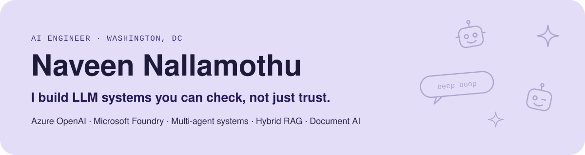
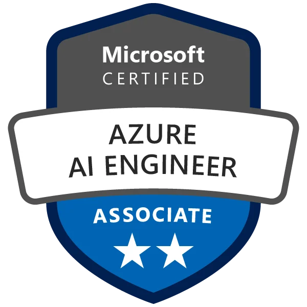
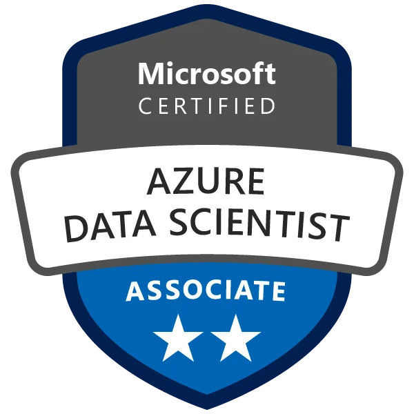
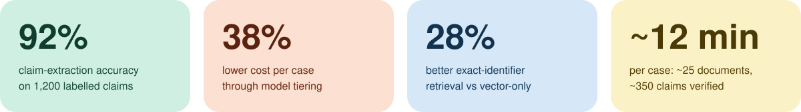
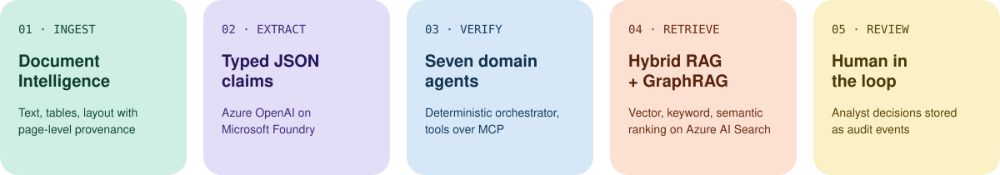
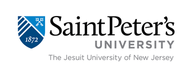

  

  
  
  

<table>
  <tr>
    <td width="30%" align="center" valign="top">
        
      
      
    </td>
    <td valign="top">
      <h3>Hi, I'm Naveen 👋</h3>
      
I'm an AI Engineer building production generative AI on Microsoft Azure: multi-agent verification, hybrid RAG and document intelligence, with every finding traced back to its source page.

      
At <b>Fact Finders Pro</b> I designed and built an evidence-backed due-diligence platform that turns pitch decks, financials and cap tables into atomic claims and verifies each one against evidence.

      

        🔭 Working on: auditable multi-agent LLM systems 
        🎓 MS in Data Science, Saint Peter's University 
        🏅 Microsoft Certified: Azure AI Engineer Associate (AI-102) and Azure Data Scientist Associate (DP-100) 
        💼 Open to AI Engineer and Generative AI Engineer roles, DC area or remote
      

    </td>
  </tr>
</table>

## 📈 Results

  

## 🧩 Featured work: evidence-backed due diligence on Azure

  

- **Secure by default:** Key Vault with Managed Identity, per-case access in Microsoft Entra ID, Azure API Management in front of every external data provider.
- **Measured, not guessed:** Application Insights tracing with per-case token and cost tracking drove the model-tiering decisions.
- **Integrated at the edges:** eight commercial credit, identity and verification APIs wrapped in Pydantic v2 schemas with idempotent requests.

## 💼 Experience

<table>
  <tr>
    <td width="30%" valign="top">
        
      <b>AI Engineer</b> 
      Aug 2024 – Present 
      Remote, USA
    </td>
    <td valign="top">
      <ul>
        <li>Designed and built the due-diligence platform end to end, from ingestion to a FastAPI service shared by engineering and product.</li>
        <li>Built LLM claim extraction reaching about 92% accuracy on a labelled evaluation set.</li>
        <li>Architected seven-agent verification with a deterministic orchestrator and MCP tools.</li>
        <li>Implemented hybrid RAG and GraphRAG; cut cost per case by about 38% with model tiering.</li>
      </ul>
    </td>
  </tr>
  <tr>
    <td width="30%" valign="top">
        
      <b>Machine Learning Engineer</b> 
      May 2021 – Jan 2023 
      Hyderabad, India
    </td>
    <td valign="top">
      <ul>
        <li>Built classification, regression and clustering models for enterprise use cases.</li>
        <li>Compared models across algorithms to pick the best fit for each problem.</li>
        <li>Automated preprocessing, cleaning and validation pipelines in Python.</li>
        <li>Integrated REST APIs between internal systems and third-party services.</li>
      </ul>
    </td>
  </tr>
</table>

## 🛠️ Toolkit

**Generative & agentic AI**

**Retrieval & documents**

**Backend & cloud**

**Evaluation & ML**

## 🎓 Education

<table>
  <tr>
    <td align="center" width="50%">
       
      <b>Master of Science, Data Science</b> 
      Saint Peter's University, Jersey City, NJ · 2023 – 2024
    </td>
    <td align="center" width="50%">
       
      <b>Bachelor of Technology, Computer Science</b> 
      JNTU Hyderabad · 2018 – 2022
    </td>
  </tr>
</table>

---

  <b>Building LLM systems that need to hold up?</b> Let's talk.  
  
  

